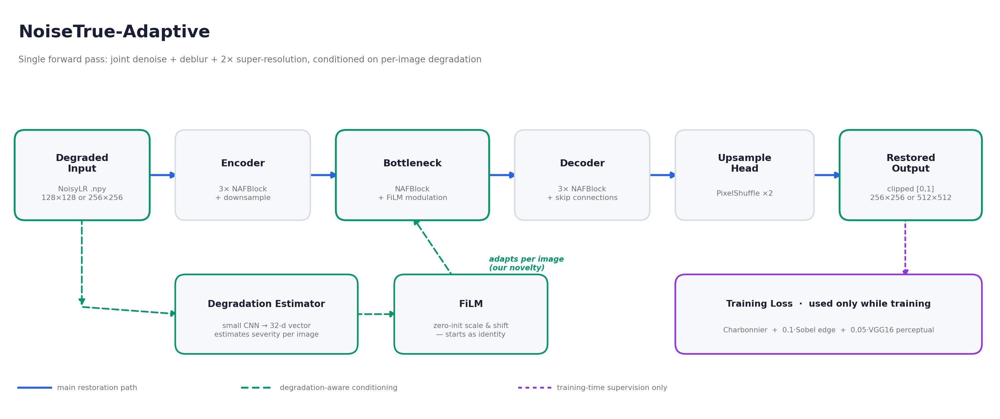
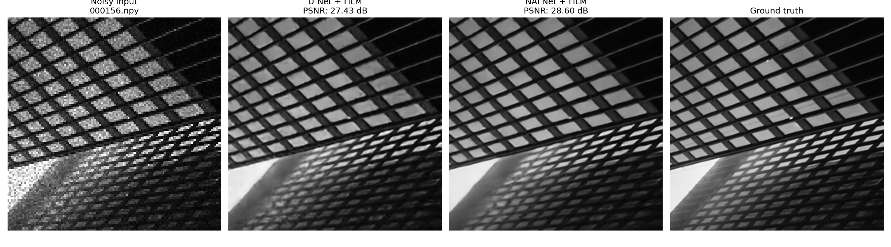
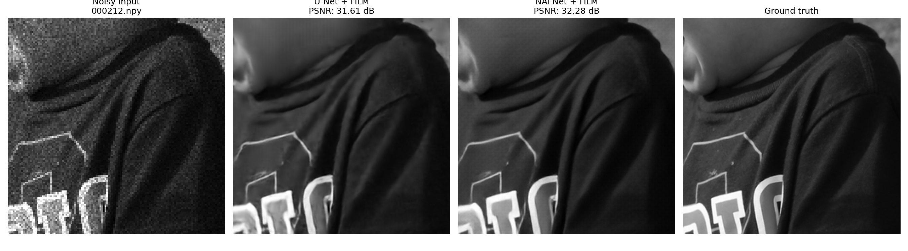

# Clarq

**Finding the true signal under the noise — with degradation-aware adaptivity.**

Submission for SEMICON India Hackathon 2026, KLA Track — *AI-Based Restoration of Degraded Images for Semiconductor Inspection*.

---

## Problem Statement

Semiconductor wafer inspection requires capturing images at the physical limits of optical and scanning electron microscopy. Inspection images routinely suffer from three concurrent degradations:

1. **Multiplicative Speckle Noise:** Arises from coherent laser illumination scattering off rough microstructures, multiplying the true signal and producing severe intensity outliers that overshoot the standard pixel intensity range.
2. **Additive Gaussian Noise:** Caused by thermal sensor noise and photonic shot noise, softening high-frequency edges and creating a hazy appearance.
3. **2× Spatial Downsampling:** Sub-Nyquist sampling loses fine pitch structures, device contacts, and boundary details.

Any combination and severity of these three degradations may be present in a single inspection image. The restored image is scored against hidden high-resolution ground truth on **PSNR**, **SSIM**, and **LPIPS** across both in-distribution and out-of-distribution structures, with end-to-end throughput (ms/image) serving as a critical metric for real-time fab integration.

---

## Dataset Details

- **Source & Origin:** Provided directly by the hackathon organizers (SEMICON India Hackathon 2026, KLA Track).
- **Data Pairs:** Paired Clean Ground Truth (`GT`) and Degraded Low-Resolution (`NoisyLR`) images.
- **Format & Precision:** Single-channel 2D arrays stored in standard NumPy binary format (`.npy`), 32-bit floating point (`float32`).
- **Dimensions:**
  - Degraded Inputs (`NoisyLR`): $128 \times 128$ or $256 \times 256$ pixels.
  - Ground Truth References (`GT`): Exactly $2\times$ spatial resolution ($256 \times 256$ or $512 \times 512$ pixels).
- **Dataset Volume & Partitioning:**
  - Total provided: 3,200 paired image files.
  - Split: 90% training split (2,880 pairs) and 10% held-out validation split (320 pairs), partitioned with a fixed random seed (`seed=42`) for deterministic reproducibility.
- **Degradation Characteristics:** Inputs reflect synthetic and physical inspection conditions (speckle noise, Gaussian haze, spatial downsampling). Due to multiplicative speckle, input intensities regularly exceed $[0, 1]$; preserving these unclipped inputs provides the network with critical physical signal dynamics.

---

## Pipeline & Architecture



### Single-Pass Joint Restoration
Traditional workflows cascade three sequential stages: denoise $\to$ deblur $\to$ super-resolve. In practice, cascading allows residual errors and ringing artifacts from earlier stages to compound into subsequent ones, while incurring high inference latency. Clarq solves all three objectives jointly in a **single forward pass** using an efficient encoder–decoder backbone ending in a PixelShuffle upsampler.

### Backbone: NAFNet-lite
Built on the principles of Nonlinear Activation Free Networks (NAFNet):
- **LayerNorm2d:** Normalizes across channels to stabilize internal feature distributions without requiring batch statistics.
- **Depthwise Convolutions:** $3 \times 3$ grouped spatial filtering isolates spatial context with minimal parameter overhead.
- **SimpleGate:** Replaces compute-heavy non-linear activations (e.g., GELU/ReLU) by splitting channels in half and taking their element-wise product ($x_1 \odot x_2$).
- **Simplified Channel Attention (SCA):** Global average pooling followed by channel-wise modulation to model inter-channel dependencies efficiently.
- **PixelShuffle 2× Head:** Upsamples features into clean high-resolution space without checkerboard artifacts.

### Key Innovation: Degradation-Aware FiLM Conditioning
Because inspection images vary widely in noise level and blur intensity, a static restoration model must compromise by learning an average restoration filter. Clarq incorporates **degradation-aware adaptivity**:
- **Degradation Estimator:** A lightweight convolutional sub-network inspects the degraded input image and extracts a 32-dimensional vector characterizing that specific image's degradation fingerprint.
- **Zero-Initialized FiLM (Feature-wise Linear Modulation):** A linear projection maps the 32-d degradation vector into per-channel scale ($\gamma$) and shift ($\beta$) parameters applied at the bottleneck:
  $$\text{FiLM}(F) = (1 + \gamma) \odot F + \beta$$
- **Identity Initialization:** By initializing the FiLM projection weights and biases to zero, $\gamma = 0$ and $\beta = 0$ at step 0. The network begins training strictly equivalent to the baseline, deviating only when learning adaptive modulation measurably reduces validation loss. This resolves the optimization instability of randomly initialized modulation layers.

---

## Multi-Objective Loss Formulation

Training balances pixel accuracy, edge sharpness, and human/deep perceptual similarity:

$$\mathcal{L}_{\text{total}} = \mathcal{L}_{\text{Charbonnier}} + 0.1 \times \mathcal{L}_{\text{Sobel}} + 0.05 \times \mathcal{L}_{\text{VGG}}$$

1. **Charbonnier Loss ($\mathcal{L}_{\text{Charbonnier}}$):**
   A smooth, differentiable $L_1$ variant ($\sqrt{\|y - \hat{y}\|^2 + \epsilon^2}$, with $\epsilon = 10^{-3}$). Robust against large outlier errors produced by multiplicative speckle noise, avoiding the over-penalization of $L_2$ loss.
2. **Sobel Edge Loss ($\mathcal{L}_{\text{Sobel}}$):**
   Computes horizontal and vertical gradients via Sobel filter kernels on both prediction and ground truth, penalizing edge smearing and sharpening critical semiconductor feature boundaries.
3. **VGG16 Perceptual Loss ($\mathcal{L}_{\text{VGG}}$):**
   Extracts multi-scale deep feature representations from a pretrained VGG16 network (relu2_2 and relu3_3). This directly targets feature-space structural similarity, strongly correlating with LPIPS.
4. **No Adversarial Loss:**
   Adversarial (GAN) losses are intentionally omitted. While GANs generate visually sharp textures, they tend to hallucinate plausible micro-patterns, creating false defect signatures that are unacceptable in metrology inspection.

---

## Results & Ablation Study

Ablation study evaluated on the 320 held-out validation pairs (fixed `seed=42`, never seen during training):

| Model Architecture | PSNR (dB) ↑ | SSIM ↑ | LPIPS ↓ | ms/img | Params |
|---|---|---|---|---|---|
| U-Net baseline | 28.236 | 0.7649 | 0.2572 | 4.82 | 1.96 M |
| U-Net + FiLM | 28.411 | 0.7662 | 0.2670 | 3.30 | 1.99 M |
| NAFNet-lite baseline | 28.295 | 0.7651 | 0.2354 | 7.79 | 1.21 M |
| NAFNet-lite + FiLM | 28.332 | 0.7666 | 0.2326 | 8.40 | 1.23 M |
| **FINAL — wide NAFNet-lite + FiLM + VGG loss** | **28.546** | **0.7682** | **0.1938** | **10.04** | **2.73 M** |

### Key Observations:
- **Consistent Superiority:** The final architecture achieves the highest PSNR (28.546 dB), highest SSIM (0.7682), and lowest LPIPS (0.1938).
- **Perceptual Realism:** The largest improvement is in LPIPS (a 17% reduction over the next best baseline), validating the multi-objective loss strategy.
- **End-to-End Speed:** **6.50 ms/image** average runtime across all 3,200 images on an NVIDIA T4 GPU. This includes disk reading, array conversion, batch inference, output sanitization/clipping, and disk writing.

---

## Visual Comparisons

Comparison across representative structural patterns from `results/sample_outputs/`:


*Dense periodic grid structure — Clarq successfully recovers delicate horizontal and vertical lattice lines that baseline models blur.*


*Structural fold and boundary contours — sharp recovery of device edges without hallucinated high-frequency ringing.*

Additional qualitative examples are available in `results/sample_outputs/`.

---

## Repository Structure

```
.
├── README.md                     # Comprehensive project documentation
├── requirements.txt              # Environment dependencies
├── run.py                        # Official inference entry point: python run.py <in> <out>
├── evaluate.py                   # Reproduces validation metric evaluation table
├── train.py                      # Standalone training script for final submitted model
├── train_colab.py                # Google Colab-ready training script with checkpointing
├── configs/
│   └── final_model_config.yaml   # Hyperparameters of the final submitted configuration
├── src/
│   ├── __init__.py               # Package marker
│   ├── model.py                  # U-Net baseline and U-Net + FiLM definitions
│   ├── model_nafnet.py           # NAFBlock, NAFNetLite, and NAFNetLiteAdaptive definitions
│   ├── dataset_and_losses.py     # Paired dataset loader, Charbonnier and Sobel loss functions
│   ├── dataset_augmented.py      # Dataset loader with geometric flip augmentations
│   ├── advanced_loss.py          # VGG16 perceptual loss implementation
│   ├── losses_v3.py              # Extended multi-loss components (FFT, MS-SSIM, Gram)
│   └── train_ablations.py        # Script reproducing the 4 ablation checkpoints
├── models/
│   ├── final_model.pth           # SUBMITTED final checkpoint (2.73M params)
│   ├── weights_README.md         # Checkpoint guide and architecture mappings
│   └── baseline-models/          # Ablation checkpoints (baseline, adaptive, nafnet)
└── results/
    ├── pipeline_diagram_clean.png# Complete pipeline architecture diagram
    └── sample_outputs/           # High-resolution visual comparison panels
```

---

## Environment Setup

Install required packages via pip:

```bash
pip install -r requirements.txt
```

---

## Running Inference

`run.py` is the official, self-contained inference script. The model architecture is implemented directly inside `run.py`, making it independent of `src/`. It automatically selects CUDA GPU if available (otherwise falls back to CPU), dynamically batches inputs with matching spatial dimensions, and sanitizes output values.

```bash
python run.py <input-dir> <output-dir>
```

### Options:
- `--model_path`: Path to model checkpoint (default: `models/final_model.pth`).
- `--base_ch`: Base channel width (default: `48` for the final submitted model).
- `--batch_size`: Batch size for inputs with identical shapes (default: `16`).

Example:
```bash
python run.py ./test_inputs ./test_outputs
```

---

## Reproducing the Evaluation Metrics

To evaluate model checkpoints on the 10% validation split (seed 42) and reproduce the reported ablation table:

```bash
python evaluate.py --gt_dir <path/to/GT> --noisy_dir <path/to/NoisyLR>
```

This script evaluates all checkpoints present in `models/` and `models/baseline-models/`, reporting PSNR, SSIM, LPIPS, per-image latency, and parameter counts. Any missing checkpoint is skipped gracefully.

---

## Reproducing Training

To retrain the submitted final model from scratch:

```bash
python train.py --gt_dir <path/to/GT> --noisy_dir <path/to/NoisyLR>
```

To reproduce the four baseline and ablation checkpoints:

```bash
python src/train_ablations.py --gt_dir <path/to/GT> --noisy_dir <path/to/NoisyLR>
```

### Training Hyperparameters
- **Optimizer:** Adam ($\beta_1=0.9, \beta_2=0.999$, weight decay $0$)
- **Learning Rate:** $1 \times 10^{-3}$ with Cosine Annealing scheduler ($T_{\max}=80, \eta_{\min}=10^{-6}$)
- **Batch Size:** 16
- **Epochs:** 80
- **Data Augmentation:** Random horizontal and vertical flips
- **Model Checkpointing:** Best validation loss model saved
- **Hardware Requirement:** Fits comfortably on a single 16 GB GPU (e.g. Google Colab T4) within a few GPU-hours.

---

## Input / Output Contract

- **Input:** `.npy` files containing single-channel 2D float32 arrays of shape $(128, 128)$ or $(256, 256)$. Raw values are preserved without clipping on load.
- **Output:** `.npy` files containing single-channel 2D float32 arrays of shape $(256, 256)$ or $(512, 512)$ ($2\times$ scale), strictly clipped to $[0.0, 1.0]$, free of NaN or Inf values, saved under the identical filename to `<output-dir>`.

---

## External Resources & Licenses

| Resource | Role / Usage | License |
|---|---|---|
| [torchvision](https://github.com/pytorch/vision) VGG16 | Perceptual loss during training only (not loaded during inference) | BSD-3-Clause |
| [`lpips`](https://github.com/richzhang/PerceptualSimilarity) (Zhang et al., 2018) | Evaluation metric computation only | BSD-2-Clause |
| [scikit-image](https://scikit-image.org/) | PSNR and SSIM metric computation | BSD-3-Clause |
| KLA Paired Dataset | Training and validation image pairs | Provided by organizers |

No private or restricted third-party weights or data were used.

---

## Limitations & Future Extensions

- **Validation Distribution:** Validation is conducted on a random 10% partition of the provided dataset. While highly indicative, performance on unseen semiconductor patterns may benefit from domain-adaptive fine-tuning.
- **FiLM Injection Points:** FiLM modulation was deployed at the bottleneck level. Exploring multi-scale FiLM injection across all encoder–decoder levels could further tune adaptive filtering.
- **Test-Time Augmentation:** Geometric self-ensembling (averaging 8-fold flips and rotations) can further increase PSNR/SSIM at the trade-off of inference latency.

---

## Academic References

1. Chen, L. et al. (2022). *Simple Baselines for Image Restoration* (NAFNet). ECCV 2022. [arxiv.org/abs/2204.04676](https://arxiv.org/abs/2204.04676)
2. Perez, E. et al. (2018). *FiLM: Visual Reasoning with a General Conditioning Layer*. AAAI 2018. [arxiv.org/abs/1709.07871](https://arxiv.org/abs/1709.07871)
3. Zhang, R. et al. (2018). *The Unreasonable Effectiveness of Deep Features as a Perceptual Metric* (LPIPS). CVPR 2018. [arxiv.org/abs/1801.03924](https://arxiv.org/abs/1801.03924)
4. Simonyan, K. & Zisserman, A. (2015). *Very Deep Convolutional Networks for Large-Scale Image Recognition* (VGG16). ICLR 2015. [arxiv.org/abs/1409.1556](https://arxiv.org/abs/1409.1556)
